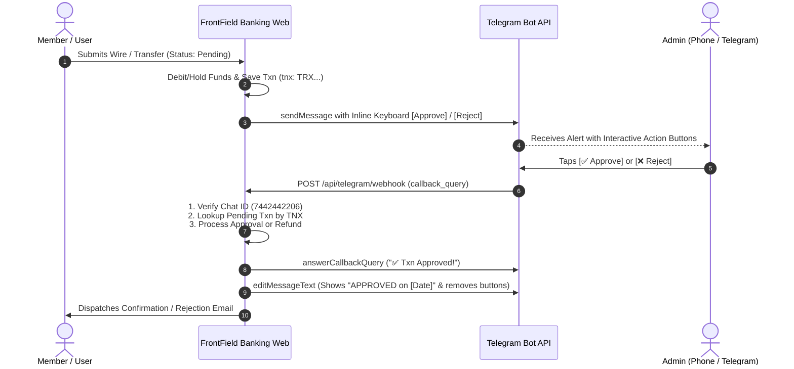

# Implementation Plan: Custom Transactions & Telegram Bot Approvals

---

## 📌 Executive Overview

This plan defines the end-to-end architecture and implementation details for two requested features:
1. **Custom Transaction Creation in Generate Modal**: Allow administrators to manually craft individual transactions with a custom description, amount, date/time, and direction (credit/income vs. debit/outgoing) directly within the existing `generateTransactions` modal on the user edit view.
2. **Telegram Bot Interactive Approvals & Rejections**: Allow authorized administrators to approve and reject pending transactions directly within Telegram via interactive inline buttons (`[ ✅ Approve ]`, `[ ❌ Reject ]`) attached to transaction alerts, as well as text commands (`/pending`, `/approve <ref>`, `/reject <ref>`).

---

## 🎯 Feature 1: Custom Transaction Creation Modal

### 1. Current State
* Currently, `resources/views/backend/user/include/__generate_transactions.blade.php` only supports **random batch generation** (selecting themes like crypto, real estate, standard retail, count 1–20, min/max amounts, and date ranges).
* Administrators cannot craft a single one-off transaction with a specific narrative (e.g., `"DIRECT DEP FED SALARY"`, `"JPMORGAN WIRE TRANSFER"`, `"REFUND OVERPAYMENT"`), exact amount, and custom timestamp without running an entire random batch.

### 2. Proposed Architecture & UI/UX Design
* **Dual-Tab Modal Layout**: Inside `__generate_transactions.blade.php`, introduce a clean Bootstrap 5 tab strip:
  * **Tab 1: ⚡ Batch Activity Generator** (Preserves the existing multi-item theme-based generator completely untouched).
  * **Tab 2: ✍️ Custom Transaction Builder** (The new feature).

#### Custom Transaction Form Fields:
1. **Target Wallet / Account**:
   * Dropdown populated with member's accounts:
     * Checking Account (`account_number`)
     * Primary Savings (`savings_account_number`)
     * IRA, HELOC, Credit Card, or multi-currency user wallets (if active).
2. **Transaction Direction / Type**:
   * Segmented toggle or radio cards:
     * **Credit / Income (`+`)**: Deposits / Inbound funds (increases balance).
     * **Debit / Outgoing (`-`)**: Withdrawals / Outbound funds (decreases balance).
3. **Transaction Amount**:
   * Input with currency prefix (`$`), step `0.01`, min `0.01`.
4. **Custom Description / Narrative**:
   * Text input with auto-uppercase option and quick-suggestion badges (e.g. `ACH DIRECT DEPOSIT`, `DOMESTIC WIRE TRANSFER IN`, `CHECK DEPOSIT`, `VENDOR PAYMENT`, `BILL SETTLEMENT`).
5. **Transaction Date & Time**:
   * `<input type="datetime-local">` defaulting to the current time, but allowing any historical or specific date/time for perfect bank statement back-dating.
6. **Execution Options**:
   * Primary Action: **`[ Post Transaction Immediately ]`** (Instant execution with balance update and success notification).
   * Secondary Action: **`[ Add to Preview List ]`** (Optional: allows queuing custom items into the existing `session("txn_preview_{$id}")` table alongside batch items).

### 3. Backend Logic & Controller Extension
* **Controller**: Extend `app/Http/Controllers/Backend/TransactionGeneratorController.php` with a new method `createCustom(Request $request, $id)`.
* **Validation Rules**:
  ```php
  $request->validate([
      'wallet_type' => 'required|string',
      'direction'   => 'required|in:income,outcome',
      'amount'      => 'required|numeric|min:0.01',
      'description' => 'required|string|max:255',
      'custom_date' => 'required|date',
  ]);
  ```
* **Balance Synchronization**:
  * Reuse existing `updateUserBalance($user, $wallet_type, $amount, $direction == 'income' ? 'add' : 'subtract')` which already handles `default` (checking), `primary_savings`, `ira`, `heloc`, `cc`, and custom wallets.
* **Ledger Entry**:
  * Create transaction using `Txn::new(...)`:
    * `amount`: `$amount`
    * `final_amount`: `$amount`
    * `charge`: `0`
    * `type`: `$direction === 'income' ? TxnType::Deposit : TxnType::Subtract`
    * `status`: `TxnStatus::Success`
    * `description`: `$request->description`
    * `method`: `'system'`
    * `userID`: `$user->id`
    * `relatedUserID`: `auth('admin')->id()`
    * `relatedModel`: `'Admin'`
    * `walletType`: `$wallet_type`
    * `created_at` & `updated_at`: `Carbon::parse($request->custom_date)`
* **Route**:
  * In `routes/admin.php`:
    ```php
    Route::post('transactions-custom-create/{id}', [TransactionGeneratorController::class, 'createCustom'])->name('transactions.custom-create');
    ```

---

## 🤖 Feature 2: Interactive Telegram Bot Approvals & Rejections

### 1. Telegram Workflow Architecture



### 2. Message Format with Interactive Inline Keyboard
When any pending transaction alert is generated (in `WireTransferService`, `FundTransferController`, or `RemoteDepositController`), `telegramNotify` will attach a dynamic `reply_markup`:

```json
{
  "reply_markup": {
    "inline_keyboard": [
      [
        {"text": "✅ Approve Transfer", "callback_data": "appr:TRX12345678"},
        {"text": "❌ Reject & Refund", "callback_data": "rejc:TRX12345678"}
      ]
    ]
  }
}
```

### 3. Telegram Webhook Controller (`TelegramWebhookController.php`)
A dedicated controller `app/Http/Controllers/TelegramWebhookController.php` will handle:

1. **Callback Queries (`callback_query`)**:
   * Triggered when the admin taps **`[ Approve ]`** or **`[ Reject ]`**.
   * **Security Check**: Enforces that `from.id` or `message.chat.id` strictly matches the authorized admin `TELEGRAM_CHAT_ID` (`7442442206` / `Setting::get('telegram_chat_id')`).
   * **State Verification**: Ensures the transaction exists and its status is still `pending`. If it was already approved or rejected, responds with: *"⚠️ Transaction already processed."*
   * **Approval Execution**:
     * Sets status to `TxnStatus::Success`.
     * If member-to-member transfer: Credits the recipient member's account.
     * Fires approval emails to member (`WireTransferApprovedMail`, `FundTransferSuccessUserMail`).
   * **Rejection Execution**:
     * Sets status to `TxnStatus::Failed`.
     * Refunds the principal amount plus charges back to the member's account (`$user->increment('balance', ...)` or `savings_balance`).
     * Fires rejection notification email to member.
   * **UI Response in Telegram**:
     * Calls `answerCallbackQuery` to dismiss the loading spinner and display a native Telegram toast: *"Transaction TRX... Approved!"*.
     * Calls `editMessageText` or `editMessageReplyMarkup` to append:
       `\n\n✅ <b>STATUS: APPROVED</b> by Admin at 2026-11-04 01:30:00`
       and removes the action buttons so it cannot be clicked again.

2. **Chat Commands (Text Messages)**:
   * `/pending`: Scans and lists all pending transactions with instant Approve/Reject button pairs.
   * `/approve <tnx>`: Approves a specific transaction reference.
   * `/reject <tnx>`: Rejects a specific transaction reference and issues an instant refund.
   * `/status <tnx>`: Returns the live status and balance impact of any transaction reference.
   * `/help`: Displays available administrative commands.

3. **Webhook Setup & Management**:
   * Add a secure helper route or Artisan command (`php artisan telegram:set-webhook` or `/telegram/setup-webhook`) that calls Telegram's `setWebhook` API to bind `https://frontfieldcu.pro/api/telegram/webhook`.

### 4. Security & Idempotency Safeguards
* **Admin Chat Whitelist**: Rejects any request not originating from the configured `TELEGRAM_CHAT_ID`.
* **Idempotency Barrier**: Atomic status check using database transactions (`DB::transaction`) so concurrent taps or network retries never double-credit or double-refund an account.
* **CSRF Exemption**: Route placed in `routes/api.php` or registered in `VerifyCsrfToken::$except`.

---

## 📂 Files to be Modified / Created

| File | Type | Purpose |
| :--- | :--- | :--- |
| `resources/views/backend/user/include/__generate_transactions.blade.php` | Modify | Add Tab 2 "Custom Transaction" form with direction, amount, custom date, and description. |
| `app/Http/Controllers/Backend/TransactionGeneratorController.php` | Modify | Add `createCustom()` action with balance update and `Txn::new` ledger creation. |
| `routes/admin.php` | Modify | Register route `transactions.custom-create`. |
| `app/Traits/TelegramTrait.php` | Modify | Enhance `telegramNotify()` to accept optional `$inlineKeyboard` parameter. |
| `app/Http/Controllers/TelegramWebhookController.php` | **Create** | Handle Telegram callbacks, approvals, rejections, commands, and message edits. |
| `app/Services/TelegramApprovalService.php` | **Create** | Encapsulate transaction approval/refund business logic shared between Admin Web and Telegram. |
| `routes/api.php` | Modify | Register `POST /api/telegram/webhook`. |
| `routes/web.php` | Modify | Register `/telegram/setup-webhook` helper route. |

---

## 🧪 Verification & Testing Strategy

1. **Custom Transaction Validation**:
   * Create an income transaction of `$1,500.00` with custom date (e.g. 5 days ago) on Checking Account &rarr; verify balance increases by `$1,500.00` and date appears accurately in ledger.
   * Create an outgoing transaction of `$45.00` on Primary Savings &rarr; verify `savings_balance` decreases by `$45.00`.
   * Verify existing batch generator in Tab 1 remains 100% functional.
2. **Telegram Bot Approvals**:
   * Submit a test Wire / External transfer &rarr; check Telegram notification arrives with `[✅ Approve]` and `[❌ Reject]` buttons.
   * Tap `[✅ Approve]` in Telegram &rarr; verify transaction updates to `success`, buttons disappear, and message updates to `APPROVED`.
   * Submit another pending transfer & tap `[❌ Reject]` &rarr; verify member account receives full refund, status updates to `failed`, and message updates to `REJECTED`.
   * Test `/pending` command in Telegram chat &rarr; verify list of pending transactions is returned.
3. **Deployment**:
   * Deploy cleanly using `.\push.ps1 "Implement custom transaction builder and Telegram bot approvals"`.

---
*Implementation plan prepared for review before modifying codebase.*

