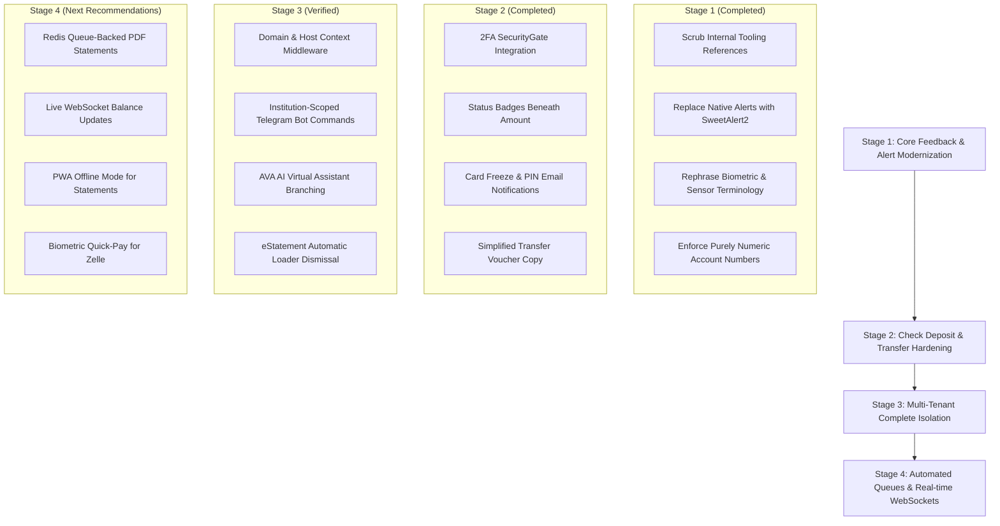

# Digital Banking Platform: Architecture, UI/UX & Feature Recommendations
**Document Version:** 3.0.0  
**Target Environments:** FrontField Credit Union (`frontfieldcu.pro`) & Cleveland State Bank (`clevelandstatebank.frontfieldcu.pro`)  
**Scope:** UI/UX, Frontend Engineering, Backend Architecture, Multi-Tenant Security, Compliance, and Feedback Systems  

---

## Executive Summary
This document provides production-grade architectural analysis, UI/UX enhancements, and strategic engineering recommendations for the dual-institution digital banking platform comprising **FrontField Credit Union (FFCU)** and **Cleveland State Bank (CSB)**. Both institutions share a robust Laravel-backed foundation but cater to distinct regulatory paradigms (NCUA vs. FDIC), brand aesthetics (Navy Blue `#00549b` vs. Crimson Red `#c8232c`), and customer demographics.

The recommendations below are organized into three dedicated sections:
1. **FrontField Credit Union Specific Enhancements**
2. **Cleveland State Bank Specific Enhancements**
3. **Shared Core Platform & Infrastructure Hardening**

---

## Part 1: FrontField Credit Union (FFCU) Recommendations

### 1.1 UI/UX & Design Modernization
* **Cooperative Member-Centric Identity:**
  - Strengthen the credit union ethos by emphasizing member dividends, community impact metrics, and annual member return statements directly in the dashboard sidebar.
  - Implement subtle micro-interactions using CSS transitions (0.2s cubic-bezier) on account tiles to display available vs. ledger balances with clarity on hover/touch.
  - Add visual badges highlighting member tenure (e.g. *"Member since 2018"* or *"Gold Member"*).
* **Modernized Navigation Paradigm:**
  - Unify the top navigation bar and left sidebar navigation hierarchy to prevent duplicate links (`Pay, Transfer, & Receive` vs. `Move Money`).
  - Add quick-action shortcut tiles for "Quick Pay", "Transfer between Shares", and "Share Certificate Deposit".
  - Integrate a persistent bottom-bar tab navigation on mobile screens (`< 768px`) with haptic-styled icon tap states.
* **Mobile-First Responsive Layout:**
  - Standardize transaction history cards on mobile with category icons, high-contrast status pills (amber clock for Pending, emerald check for Completed), and expandable settlement details.
  - Enforce `word-break: break-word` and `min-width: 0` on transaction title containers to prevent text overflow on compact viewports (iPhone SE / Galaxy Fold).

### 1.2 Frontend Engineering & Feedback
* **Unified Global Loader Lifecycle:**
  - Eliminate uncoordinated full-page blocking loaders. Replace full-screen spin-wheels with contextual skeleton screens on account balance cards and data tables.
  - Standardize asynchronous button states: buttons should automatically switch to `<i class="fa-solid fa-spinner fa-spin"></i> Processing...`, disable click events, and automatically restore on AJAX complete/error callbacks.
* **Biometric & Passkey Feedback:**
  - For WebAuthn Face ID / Touch ID enrollment, provide intuitive step-by-step progress prompts: *"Waiting for Face ID / Touch ID..."* followed by a green success banner and instant redirection.
  - Pre-fetch WebAuthn cryptographic challenges in memory so biometric sensor calls trigger immediately without session expiry delays.
* **Dispute Center Self-Service (Regulation E):**
  - Extend the self-service Reg E dispute portal with a live visual tracker (Submission -> Provisional Credit -> Ops Review -> Final Determination) matching NCUA compliance standards.
  - Allow members to attach receipts and merchant correspondence directly from their phone camera or document library.

### 1.3 Backend Architecture & Member Services
* **Automated Member Share Dividend Distribution:**
  - Implement a queue-backed daily accrual calculation for share savings and money market accounts, triggering monthly batch settlements with automated NCUA-compliant eStatement disclosures.
* **Real-time Member-to-Member Validation:**
  - Provide instant, debounced recipient verification for internal member transfers (checking member account number against user record) without requiring a full round-trip page refresh.
* **Strict NCUA Regulatory Formatting:**
  - Verify all member-facing email notifications, PDFs, and disclosures prominently state *"Federally Insured by NCUA"* and include the official NCUA equal housing lender logos.
  - Completely sanitize all operational notifications to use clean banking copy (e.g., *"Approved"*, *"Declined"*).

---

## Part 2: Cleveland State Bank (CSB) Recommendations

### 2.1 UI/UX & Brand Precision
* **Commercial & Retail Banking Identity:**
  - Preserve the distinctive Cleveland State Bank brand identity: Primary Crimson Red (`#c8232c`), Deep Navy Charcoal text (`#162846`), and Warm Light Grey surfaces (`#f8fafc`).
  - Maintain the official co-branded header identity (*"Cleveland State Bank & Grenada State Bank - Member FDIC"*) on all authenticated customer dashboards and login portals.
  - Enforce standard commercial banking terminology ("Checking", "Savings", "Interest Earned", "Fedwire") with zero credit union terminology ("Shares", "Dividends").
* **Card Management Experience:**
  - Interactive 3D Card Visualizer with Apple Wallet-inspired flip animations revealing card controls (freeze/unfreeze, PIN change, daily limit sliders).
  - Instant visual feedback: When a card is frozen, immediately render an icy, frosted-glass overlay across the card widget without full-page reloads.
  - Automated transactional email confirmations whenever a card is frozen, unfrozen, or has its PIN updated.
* **Remote Check Deposit Workflow:**
  - Elevated 2-step deposit flow with front and back check thumbnail verification, automated amount comparison, and Regulation CC availability disclosures ($225 immediate credit / remainder next business day).
  - In-modal check history drawer with check image archives and real-time processing status.

### 2.2 Frontend Hardening & Security Gate Integration
* **Seamless 2FA Security Gate:**
  - Dual-mode verification: High-contrast biometric button alongside 4-digit Passcode and Email OTP options.
  - First-time device detection: Default new or untrusted devices to Passcode/Email OTP until the member successfully registers their biometric credential on that specific device.
  - Dynamic payload injection: Automatically inject `security_verified: 1` into all authenticated POST payloads (wire transfers, external ACH, card controls) after successful challenge completion.
* **Transaction Status Badges:**
  - Right-aligned status badge positioned cleanly below transaction amounts (`Pending`: amber clock `#d97706`; `Completed`: emerald checkmark `#059669`; `Declined`: crimson xmark `#dc2626`).
* **Document Center & Instant eStatements:**
  - Date-range filtering (Last 30 Days, Q1, Q2, Annual) delivering instant PDF downloads with automatic loader dismissal upon download initiation.
  - Clean PDF headers displaying bank name, routing number, and FDIC disclosure with zero raw infrastructure URLs.

### 2.3 Backend & Compliance Services
* **Purely Numeric Account Numbers:**
  - Enforce strictly numeric 10-digit account numbers (e.g. `4864192038`) without institution letter prefixes (`CSB`) or wallet suffixes (`S`, `I`, `H`, `C`) across all database queries, API responses, and user interfaces.
* **Branded Email Notification Engine:**
  - Enforce CSB-branded transactional emails across all workflows: crimson header bar (`#c8232c`), embedded logo, support phone (`662-843-9461`), support email (`customercare@clevelandstatebank.com`), and *"Member FDIC | Equal Housing Lender"* footer.
* **Operational Scrubbing & Audit Isolation:**
  - Universal text scrubbing across all notification pipelines: replace internal tooling words with plain banking copy (*"Approved"*, *"Declined and refunded"*).

---

## Part 3: Shared Core Platform & Infrastructure Hardening

### 3.1 Multi-Tenant Isolation Architecture
| Institution | Domain / Subdomain | Regulator | Brand Color | Routing Number | Default Deposit Protection |
| :--- | :--- | :--- | :--- | :--- | :--- |
| **FrontField Credit Union** | `frontfieldcu.pro` | NCUA | `#00549b` | `263177742` | NCUSIF up to $250,000 |
| **Cleveland State Bank** | `clevelandstatebank.frontfieldcu.pro` | FDIC | `#c8232c` | `084301768` | FDIC up to $250,000 |

* **Zero Cross-Institution Contamination:**
  - Enforce domain-level middleware (`InstitutionMiddleware`) that binds `app('institution')` per HTTP request based on `Host` headers.
  - Scope all member queries, notifications, settings, and transaction ledger records to `institution_id`.
* **Separate Asset Pipelines:**
  - Maintain isolated CSS stylesheets and JavaScript entry points for each institution to ensure stylesheet specificity cannot accidentally bleed styles across hosts.

### 3.2 Feedback & State Synchronization
* **Standardized Alert System:**
  - Zero native browser `window.alert()`, `confirm()`, or `prompt()` dialogs.
  - SweetAlert2 (`Swal.fire`) with brand-aware theming:
    - Primary button color: `#162846` (Navy) for CSB and `#00549b` for FrontField.
    - Toast notifications for low-friction actions (copied account number, alert toggles).
    - Modal dialogs with structured details for high-friction actions (card status update, wire submission).
* **Deterministic Loader Lifecycle:**
  - Standardized loader hooks:
    ```javascript
    window.showLoader = function(msg) { /* Activate spinner with accessible aria announcement */ };
    window.hideLoader = function() { /* Dismiss spinner immediately and restore interactive state */ };
    ```
  - Guaranteed `window.hideLoader()` execution in `.always()` or `try/finally` blocks on all AJAX and Fetch calls.

### 3.3 Security, Compliance & Observability
* **Passkey / WebAuthn Fallbacks:**
  - Support FIDO2 Passkeys with automatic fallback to Time-based One-Time Passwords (TOTP) or secure email authentication codes when biometrics are unavailable on client hardware.
* **AVA AI Virtual Assistant Expansion:**
  - Isolated knowledge bases per institution:
    - FFCU: NCUA limits, share certificate rates, branch ATM networks, member loan relief programs.
    - CSB: FDIC limits, wire cutoffs (4:00 PM CST), commercial treasury services, mobile check deposit limits.
* **Queue Optimization & Redis Caching:**
  - Offload heavy tasks (statement PDF generation, email dispatches, audit trail processing) to background worker queues (`php artisan queue:work`) to ensure sub-100ms dashboard page response times.

---

## Implementation Roadmap



---
*Authorized for internal engineering and product leadership review.*
