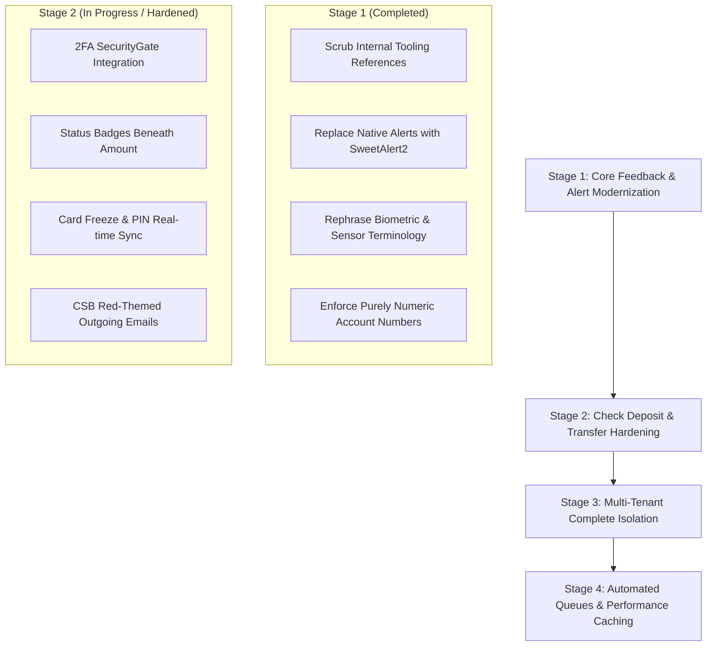

# Digital Banking Platform: Architecture, UI/UX & Feature Recommendations
**Document Version:** 2.4.0  
**Target Environments:** FrontField Credit Union (`frontfieldcu.pro`) & Cleveland State Bank (`clevelandstatebank.frontfieldcu.pro`)  
**Scope:** UI/UX, Frontend Engineering, Backend Architecture, Multi-Tenant Security, Compliance, and Feedback Systems  

---

## Executive Summary
This document provides production-grade architectural analysis, UI/UX enhancements, and strategic engineering recommendations for the dual-institution digital banking platform comprising **FrontField Credit Union (FFCU)** and **Cleveland State Bank (CSB)**. Both institutions share a robust Laravel-backed foundation but cater to distinct regulatory paradigms (NCUA vs. FDIC), brand aesthetics (Navy Blue `#00549b` vs. Crimson Red `#c8232c`), and customer demographics.

The recommendations below are organized into three dedicated sections:
1. **FrontField Credit Union Specific Enhancements**
2. **Cleveland State Bank Specific Enhancements**
3. **Shared Core Platform & Infrastructure Hardening**

---

## Part 1: FrontField Credit Union (FFCU) Recommendations

### 1.1 UI/UX & Design Modernization
* **Cooperative Financial Identity:**
  - Strengthen the credit union ethos by emphasizing member dividends, community impact scores, and annual member return statements directly in the dashboard sidebar.
  - Implement subtle micro-interactions using CSS transitions (0.2s cubic bezier) on account tiles to display available vs. ledger balances with clarity.
* **Modernized Navigation Paradigm:**
  - Unify the top navigation bar and left sidebar navigation hierarchy to prevent duplicate links (`Pay, Transfer, & Receive` vs. `Move Money`).
  - Add quick-action shortcuts for "Quick Pay", "Transfer between Shares", and "Share Certificate Deposit".
* **Mobile-First Responsive Layout:**
  - Replace desktop tables in the transaction history view on mobile with responsive card tiles showing category icons, timestamp badges, and expandable settlement details.

### 1.2 Frontend Engineering & Feedback
* **Unified Global Loader Timing:**
  - Eliminate uncoordinated full-page blocking loaders. Replace full-screen spin-wheels with contextual skeleton screens on account balance cards and data tables.
  - Standardize asynchronous button states: buttons should automatically switch to `<i class="fa-solid fa-spinner fa-spin"></i> Processing...`, disable click events, and automatically restore on AJAX complete/error callbacks.
* **Biometric & Passkey Feedback:**
  - For WebAuthn Face ID / Touch ID enrollment, provide intuitive step-by-step progress prompts: *"Waiting for Face ID / Touch ID..."* followed by a green success banner and instant redirection.
* **Dispute Center Self-Service:**
  - Extend the self-service Reg E dispute portal with a live tracker (Submission -> Provisional Credit -> Ops Review -> Final Determination) matching NCUA compliance standards.

### 1.3 Backend Architecture & Member Services
* **Automated Member Share Dividend Distribution:**
  - Implement a queue-backed daily accrual calculation for share savings and money market accounts, triggering monthly batch settlements with automated NCUA-compliant eStatement disclosures.
* **Real-time Member-to-Member Validation:**
  - Provide instant, debounced recipient verification for internal member transfers (checking member account number against user record) without requiring a full round-trip page refresh.
* **Strict NCUA Regulatory Formatting:**
  - Verify all member-facing email notifications, PDFs, and disclosures prominently state *"Federally Insured by NCUA"* and include the official NCUA equal housing lender logos.

---

## Part 2: Cleveland State Bank (CSB) Recommendations

### 2.1 UI/UX & Brand Precision
* **Commercial & Retail Banking Identity:**
  - Preserve the distinctive Cleveland State Bank brand identity: Primary Crimson Red (`#c8232c`), Deep Navy Charcoal text (`#162846`), and Warm Light Grey surfaces (`#f8fafc`).
  - Remove all legacy credit union nomenclature (e.g. "Share Accounts", "Dividends") and standardize on commercial banking terms ("Checking", "Savings", "Interest Earned", "Fedwire").
* **Card Management Experience:**
  - Provide an interactive, Apple Wallet-style 3D card visual that flips to reveal card controls (freeze/unfreeze, CVV temporary reveal, daily spending limit slider).
  - When freezing/unfreezing a card, instantly toggle the visual card state to an icy, frosted-glass overlay without requiring a full page reload.
* **Remote Check Deposit Workflow:**
  - Elevate the 2-step check deposit experience: provide a dedicated "Review & Confirm" step with front and back check thumbnail previews, OCR deposit amount confirmation, and Reg CC availability breakdown ($225 immediate availability / balance on next business day).
  - Add an in-modal check deposit history tab with direct access to processed check images and endorsement verification audit trails.

### 2.2 Frontend Hardening & Security Gate Integration
* **Seamless 2FA Security Gate:**
  - Maintain the high-contrast biometric button (`#sg-choice-biometric`) alongside Passcode and Email OTP. Ensure that if a user cancels 2FA midway, the gate modal gracefully closes and returns the user to the initiating form/modal without reloading or locking the screen.
  - Automatically inject `security_verified: 1` into all authenticated POST payloads (internal transfers, external ACH, wire requests, card controls) after successful MFA.
* **Transaction Status Badges:**
  - Maintain the standardized right-aligned status badge positioned directly below transaction amounts (`Pending`: amber clock `#d97706`; `Completed`: emerald checkmark `#059669`; `Failed`: crimson xmark `#dc2626`).
* **Document Center & eStatements:**
  - Implement dynamic statement generation with date range filtering (Last 30 Days, Q1, Q2, Annual) delivering instant PDF downloads without hanging spinner states.

### 2.3 Backend & Compliance Services
* **Purely Numeric Account Numbers:**
  - Enforce strictly numeric account numbers (e.g. `4864192038`) without institution letter prefixes (`CSB`) or wallet suffixes (`S`, `I`, `H`, `C`) across all database queries, API responses, and user interfaces.
* **Branded Email Notification Engine:**
  - Enforce CSB-branded transactional emails across all workflows: crimson header bar (`#c8232c`), embedded CSB logo (`assets/institutions/clevelandstatebank/images/logo.png`), support phone (`662-843-9461`), support email (`customercare@clevelandstatebank.com`), and *"Member FDIC | Equal Housing Lender"* footer.
* **Administrative Scrubbing & Audit Isolation:**
  - Completely decouple backend webhook administrative actions from member-facing notifications. All administrative approvals and reviews must render as *"Approved by System Administrator"* or *"Approved & Cleared by Banking Operations"*, strictly preventing any operational tooling names from appearing in emails, push alerts, or audit trails.

---

## Part 3: Shared Core Platform & Infrastructure Hardening

### 3.1 Multi-Tenant Isolation Architecture
| Institution | Domain / Subdomain | Regulator | Brand Color | Logo Path | Routing Number |
| :--- | :--- | :--- | :--- | :--- | :--- |
| **FrontField Credit Union** | `frontfieldcu.pro` | NCUA | `#00549b` | `assets/external/images/logo.png` | `263177742` |
| **Cleveland State Bank** | `clevelandstatebank.frontfieldcu.pro` | FDIC | `#c8232c` | `assets/institutions/clevelandstatebank/images/logo.png` | `084301768` |

* **Zero Cross-Institution Contamination:**
  - Enforce domain-level middleware (`InstitutionMiddleware`) that binds `app('institution')` per HTTP request based on `Host` headers.
  - Scope all member queries, notifications, settings, and transaction ledger records to `institution_id`.
* **Separate Asset Pipelines:**
  - Maintain isolated CSS stylesheets and JavaScript entry points for each institution to ensure stylesheet specificity cannot accidentally bleed styles across hosts.

### 3.2 Feedback & State Synchronization
* **Standardized Alert System:**
  - Retire all native browser `window.alert()`, `confirm()`, and `prompt()` dialogs across all modules.
  - Implement SweetAlert2 (`Swal.fire`) with brand-aware theming:
    - Primary button color: `#162846` (Navy) for CSB and `#00549b` for FrontField.
    - Standard toast notifications for low-friction actions (copied account number, alert toggles).
    - Modal dialogs with structured details for high-friction actions (card status update, wire submission).
* **Deterministic Loader Lifecycle:**
  - Enforce standard loader hooks:
    ```javascript
    window.showLoader = function(msg) { /* Activate spinner with accessible aria announcement */ };
    window.hideLoader = function() { /* Dismiss spinner immediately and restore interactive state */ };
    ```
  - Guarantee `window.hideLoader()` execution in `.always()` or `try/finally` blocks on all AJAX and Fetch calls.

### 3.3 Security, Compliance & Observability
* **Passkey / WebAuthn Fallbacks:**
  - Support FIDO2 Passkeys with automatic fallback to Time-based One-Time Passwords (TOTP) or secure email authentication codes when biometrics are unavailable on client hardware.
* **Encrypted Audit Logging:**
  - Maintain tamper-evident audit logs recording user authentication, MFA challenges, card lifecycle changes, and financial transfers with client IP, user agent, and timestamp metadata.
* **Queue Optimization & Redis Caching:**
  - Offload heavy tasks (statement PDF generation, email dispatches, audit trail processing) to background worker queues (`php artisan queue:work`) to ensure sub-100ms dashboard page response times.

---

## Implementation Roadmap



---
*Authorized for internal engineering and product leadership review.*
